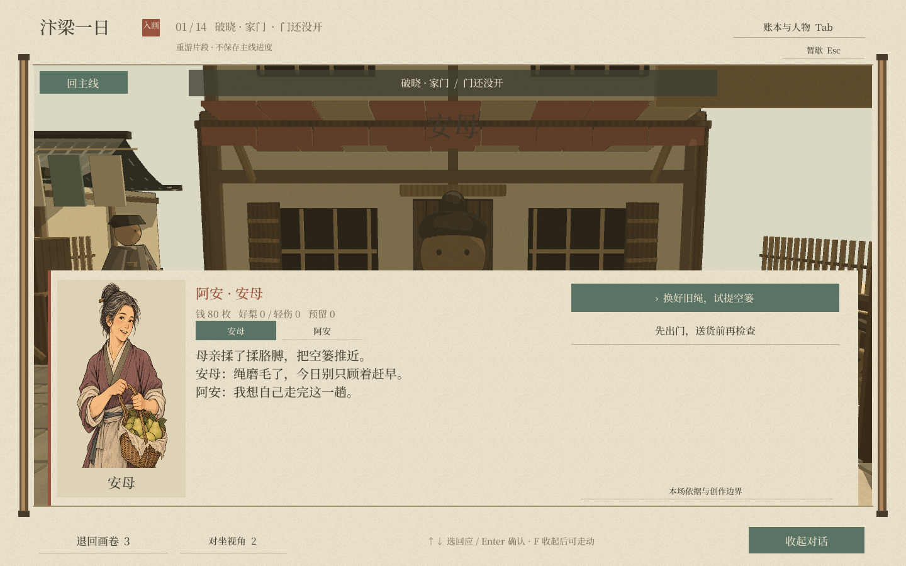

# 清明上河图 · 汴梁一日

基于《清明上河图》的市井生活体验 Demo。玩家扮演卖梨的阿安，经历进货、买卖、送货、回访和夜归对账。

## 当前内容

- Unity / 团结引擎主工程，以及原 Godot 工程。
- 十四场连续故事、四类结局、钱货账目与人物约定。
- 拿取、翻面验货、分类、数钱、提篓步行送货和人物接收/拒收反馈。
- 画卷进入三维的色调过渡、细化街道与河岸环境。
- 十三位人物的原创淡彩立绘及对话界面。
- Unity MCP 编辑器包、服务端源码、历史研究和迁移工具。

## 打开工程

### 当前可复现基线

Unity 工程：`UnityProject`，主场景：`Assets/Scenes/Qingming.unity`。
原验证编辑器为团结引擎 1.10.4（内部版本 2022.3.62t16），验证平台为 Windows。
在 Hub 中添加 `UnityProject`，等待首次导入后打开主场景并播放。

请保留 `UnityProject` 与 `tools` 的相对位置：MCP 是相对路径本地包依赖。
首次导入需要下载包依赖、重建缓存。编译后的 Windows 程序和安装器不在源码仓库内。
编辑器菜单 `Qingming > Build Windows Demo` 可重新构建 Windows 版。

原 Godot 工程入口为根目录 `project.godot`。该版本用于参考，最新剧情与立绘在 Unity 工程中。

### M4 Max / Mac 与 Vision Pro

最终目标是 Apple Vision Pro；目前仓库是桌面体验基线，尚未通过 Mac 或 visionOS 实机验证。
Apple silicon Mac 开发交接说明及头显改造清单在 `tools/mac-handoff/`。
Windows 上执行 `python tools/mac-handoff/package_mac.py` 可生成带完整性校验的 Mac 开发交接包；不要直接把本机 Windows 缓存或虚拟环境复制到 Mac。
Mac 打开步骤、版本标记调整和原配置备份均在交接说明中明确记录。
Vision Pro 仍需改造 XR 相机、注视/捏合输入、空间 UI，并完成对应渲染路线及真机验证。

## 主要目录

| 目录 | 内容 |
|---|---|
| `UnityProject/Assets` | 最新场景、脚本、材质、字体、原画分块与人物立绘 |
| `tools/unity-mcp` | 上游 MCP 代码副本，版本见 `UPSTREAM.txt` |
| `tools/unity-port` | 场景导出、依赖准备与资源验证工具 |
| `tools/mac-handoff` | Mac 打包工具、启动脚本和 Vision Pro 开发清单 |
| `scripts`、`scenes`、`assets` | 原 Godot Demo 代码与素材 |
| `剧本`、`美术`、`captures`、`pre` | 剧本研究、人物图鉴、截图与已有展示材料 |

## 操作与验证

WASD 走动，右键环顾；E 操作/确认，F 展开对话，R 翻面，Q 放回；Tab 账本，Esc 暂停。
详细规则见 [故事版体验说明](阿安故事版体验说明.txt)。
2026-10-21 的 Windows 验证记录覆盖十四场、四类结局、12 条定向路线和 240 条固定种子路线，另有实物交互和立绘资源检查。
结果见 `tools/unity-port/UnityRuntimeTest.txt`。这些结果不代表已通过 Mac 或 Vision Pro 测试。

## 依赖与来源

第三方素材来源见 [THIRD_PARTY_NOTICES.txt](THIRD_PARTY_NOTICES.txt)，字体许可在 `assets/fonts`，原画来源在 `assets/painting/source.json`。
MCP 采用上游 MIT 许可，原文保存在 `tools/unity-mcp/LICENSE`。本仓库没有为原创项目内容额外指定开源许可。

本仓库不包含编辑器、安装器、缓存、账号凭据、旧压缩包和生成后的应用。源码文件复制校验记录见 `SOURCE_SNAPSHOT.json`。
